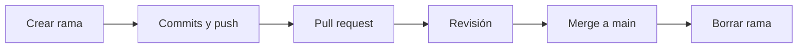

# 🐙 prueba-gh900

> Repositorio de práctica para la certificación **GitHub Foundations (GH-900)**.
> Aquí se hacen, con ejemplos reales, los ejercicios de cada día del plan de estudio.


## 🎯 Objetivo

Validar con práctica real los dominios del examen GH-900: Git y GitHub básicos, repositorios, colaboración, desarrollo moderno, proyectos, seguridad y comunidad.

## 🗓️ Plan de 7 días (30 min diarios)

| Día | Fecha | Tema | Práctica en este repo |
|---|---|---|---|
| 1 | 2 nov | Git vs GitHub, GitHub Flow, tipos de cuenta | Organización y repo creados |
| 2 | 3 nov | Archivos del repo (README, CODEOWNERS, SECURITY…) | CODEOWNERS y plantilla de issue |
| 3 | 4 nov | Issues, PRs, Discussions, Gists, Pages | PR con `Fixes #n` |
| 4 | 5 nov | Actions, Copilot, Codespaces | Codespace con `devcontainer.json` |
| 5 | 6 nov | Projects, seguridad y administración, comunidad | Protección de rama y un Project |
| 6 | 7 nov | Simulacro 1 | — |
| 7 | 8 nov | Repaso y simulacro 2 | — |

## ✅ Progreso

- [x] Día 1: organización y repositorio creados
- [ ] Día 2: archivos del repositorio
- [ ] Día 3: issues y pull requests
- [ ] Día 4: Actions, Copilot y Codespaces
- [ ] Día 5: proyectos, seguridad y comunidad
- [ ] Día 6: simulacro 1
- [ ] Día 7: repaso y simulacro 2

## 🔀 Flujo de trabajo (GitHub Flow)

Todo cambio entra por una rama corta y un pull request, nunca directo a `main`:



Ejemplo de comandos:

```bash
git switch -c dia2-codeowners
git add .
git commit -m "Añade CODEOWNERS"
git push -u origin dia2-codeowners
```

## 📝 Convenciones

- Ramas con nombres cortos y descriptivos: `dia2-codeowners`, `dia3-pr-fixes`.
- Un cambio por rama y un propósito por commit.
- Los PRs cierran sus issues con una palabra clave por issue, por ejemplo `Fixes #1, fixes #2`.

## 📚 Recursos

- [Guía oficial del examen GH-900](https://learn.microsoft.com/en-us/credentials/certifications/resources/study-guides/gh-900)
- [GitHub Flow (docs oficiales)](https://docs.github.com/en/get-started/using-github/github-flow)
- [Curso interactivo Introduction to GitHub](https://github.com/skills/introduction-to-github)

---

#Avances
Editamos el README.md para el día 3

Hecho con 💙 por **Leonardo** · Práctica para GitHub Foundations
